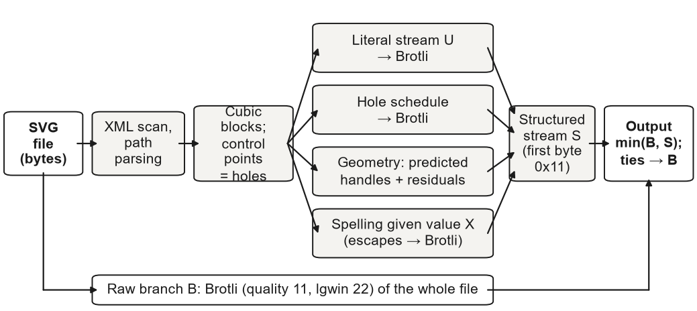
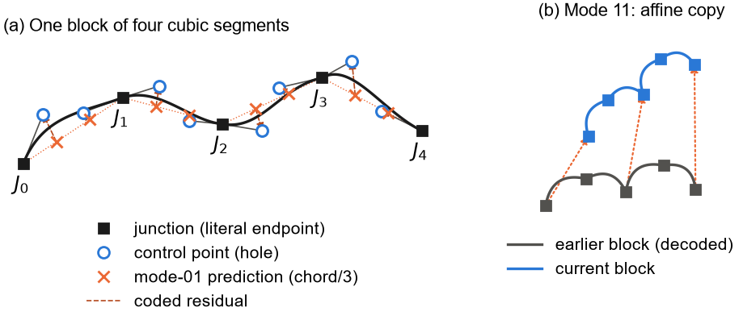
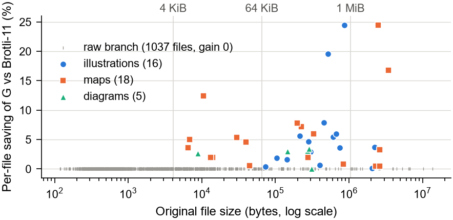
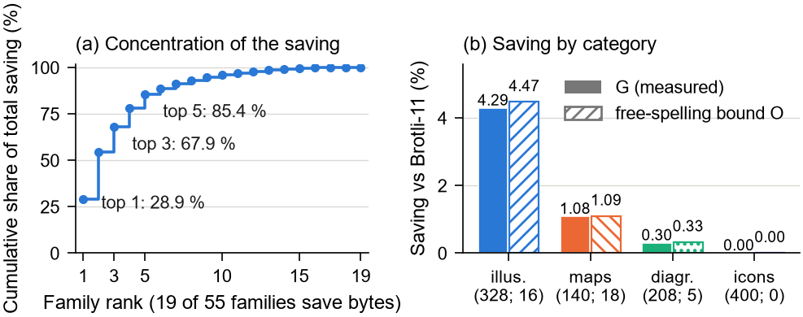
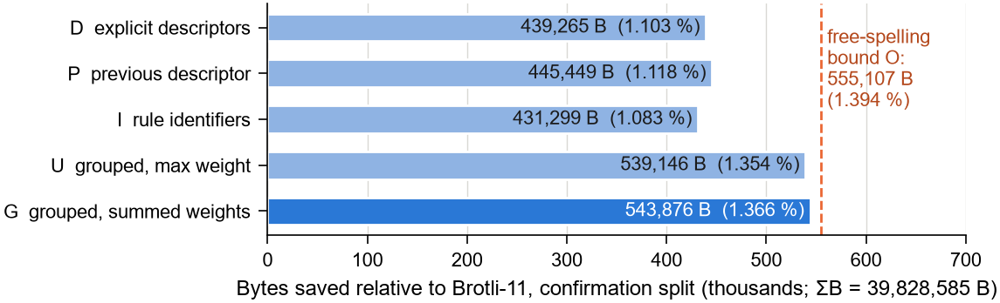

# SVGX: Byte-Exact SVG Compression

SVGX is a lossless compressor for Scalable Vector Graphics (SVG) files that returns the **original byte string exactly** and exploits the geometry of the drawing:

- it predicts the control points of cubic Bézier curves from geometry that the decoder has already decoded;
- it restores the decimal spelling of each predicted coordinate with a model conditioned on the coordinate's value.

A structured stream is emitted only when it is smaller than a whole-file Brotli stream (quality 11, window 22). The output is therefore never larger than that Brotli stream.

This repository contains:
- the encoder and decoder (Rust) and an independent Python reference decoder;
- the format specification, the proofs and the frozen experimental protocol;
- the corpus manifests;
- every per-file measurement of the completed study, the summary tables and the figures;
- the scripts that regenerate the tables and figures from the saved measurements.

---

## 1. The problem

SVG paths are text, for example `<path d="M10 20C13.3 25.1 18.7 25.1 22 20…">`. Files are usually stored and served with general-purpose compressors (gzip, Brotli, Zstandard). These see a byte string, not curves.

SVG optimizers make files smaller by rewriting them: they round coordinates, drop characters and change command forms. The picture usually looks the same, but the bytes change. That is unacceptable whenever the file itself must be preserved, for example when it is identified by a cryptographic digest (Subresource Integrity, content-addressed storage), kept under version control, or archived with fixity checks.

SVGX addresses the case in which **the decoder must return exactly the original bytes** and asks how much path geometry can still help.

### What "byte-exact" means here

| Fidelity level | Guarantee | SVGX |
|---|---|---|
| **Byte-exact** | `decode(encode(x)) == x`, the same bytes and the same SHA-256 | **yes, this is the only level SVGX targets** |
| Document equivalence | same XML information set; whitespace, attribute order, quoting may differ | (implied) |
| Numeric-value preservation | every number keeps its value, but `0.50` may become `.5` | (implied) |
| Visual equivalence | renders the same within a tolerance (what SVG optimizers aim for) | (implied) |

Byte-exactness is checked by comparing the SHA-256 digest of the restored file with that of the original.

---

## 2. How SVGX works



1. **Container.**
   - The output is `C = min(B, S)`, where `B` is a Brotli-11 stream of the whole file and `S` is the structured stream (ties choose `B`).
   - Structured streams start with the byte `0x11`. RFC 7932 §9.1 makes this byte impossible as the first byte of a standard Brotli stream, so selecting the branch costs **0 bytes**.
2. **What is modelled.**
   - Only the `d` attribute of SVG-namespace `<path>` elements is modelled.
   - A run of consecutive cubic groups (`C`/`c`) is cut into blocks of four segments.
   - The 16 control coordinates of each block become *holes*; all other bytes form a literal stream that is compressed with Brotli.
3. **Geometric prediction.**
   - Each block is predicted with one of four modes:
     - `00` zero;
     - `01` straight (chord/3);
     - `10` smooth continuation, with a mirror-symmetric second handle;
     - `11` affine copy of an earlier block within a 4,096-block window.
   - All arithmetic uses exact integers on a per-path decimal grid with explicit bounds.
   - Residuals are coded with an order-*p* exponential-Golomb code; *p* is chosen per block.
4. **Value-conditioned spelling.**
   - After geometry decoding, the decoder knows each coordinate's exact value but not how it was written (`0.5`, `.5`, `0.50`…).
   - Five variants restore the spelling and differ only in this step:

     | Variant | How the spelling is stored |
     |---|---|
     | **D** | explicit format descriptors |
     | **P** | the previous descriptor of the same role |
     | **I** | identifier of a matching formatting rule |
     | **U** | groups of rules with identical output, maximum weight |
     | **G** (primary) | the same groups, summed weights |

   - Symbols are arithmetic-coded with adaptive weights.



The normative specification is [`docs/FORMAT.md`](docs/FORMAT.md). The reconstruction and size-bound proofs are in [`docs/PROOF.md`](docs/PROOF.md), and the frozen study protocol is in [`docs/PROTOCOL.md`](docs/PROTOCOL.md).

---

## 3. Results

All results come from one completed run, `results/20261114_050438_SVGX-2026-11-A`. The design was frozen (SHA-256 of 53 files) before any measurement on real files, and a single build was used throughout.

| Label | What it is | Where |
|---|---|---|
| **Pilot** | 248 files, 34 provenance families. Used only to fix the control C\* (rule frozen in advance: P) and to evaluate the pilot targets | `results/…/*pilot*` |
| **Final (confirmation)** | 1,076 files, 55 families, none shared with the pilot. All headline numbers below | `results/…/*confirmation*` |
| **Diagnostic (post hoc)** | Independent recomputation, completeness correction, concentration, seed sensitivity, targeted re-decoding | `audit/presubmission_20261115/`, `analysis/output/` |

**Corpus (confirmation split):**

| Category | Files | Families | MB |
|---|---:|---:|---:|
| Maps | 140 | 18 | 89.16 |
| Illustrations | 328 | 23 | 15.26 |
| Diagrams | 208 | 9 | 16.91 |
| Icons | 400 | 11 | 0.24 |

The files are publicly available from 51 sources (npm packages, GitHub repositories pinned to commits, Wikimedia Commons revisions); see [§6](#6-data-and-licences).

### 3.1 Reconstruction correctness

- **All 1,324 files** (pilot and confirmation) were restored byte for byte in every variant. Each final stream and each forced structured stream was decoded by **both** the Rust decoder and the Python reference decoder.
- The raw branch was byte-identical to the stream of the reference `brotli` tool for 1,324/1,324 files.
- Every comparator stream decoded to the original.
- All 16,444 measurement jobs completed, with 0 failed attempts.

This is evidence for the measured corpus. It is not a proof for all inputs; the proof for the specification is in `docs/PROOF.md`.

### 3.2 Compression (final split)

The gain is `100·(ΣA − ΣC_G)/ΣA`, a ratio of byte totals. The interval is a family-cluster bootstrap with 50,000 resamples and Bonferroni adjustment over the three confirmatory contrasts.

| Contrast | ΣA (bytes) | Gain of G (%) | Files W/T/L | Families W/T/L | Bonferroni interval (%) |
|---|---:|---:|---|---|---|
| G vs C\* (= P) | 39,383,136 | 0.250 | 39/1037/0 | 19/36/0 | [0.081, 1.146] |
| G vs U | 39,289,439 | 0.012 | 37/1037/2 | 18/36/1 | [0.001, 0.061] |
| **G vs Brotli-11** | 39,828,585 | **1.366** | 39/1037/0 | 19/36/0 | **[0.221, 7.199]** |
| G vs XWRT 3.4 `-l6` | 39,744,103 | 1.156 | 1010/0/66 | 41/0/14 | — |
| G vs xz 5.8.4 `-9e` | 39,841,636 | 1.398 | 1057/0/19 | 50/0/5 | — |
| G vs Zstandard 1.5.7 `-19` | 40,732,175 | 3.554 | 1070/0/6 | 54/0/1 | — |
| G vs 7-Zip 26.05 PPMd `-mx=9` | 41,171,450 | 4.583 | 1011/0/65 | 44/0/11 | — |
| G vs GNU gzip 1.15 `-9` | 46,627,803 | 15.748 | 1075/0/1 | 55/0/0 | — |

ΣC_G = 39,284,709 bytes.

**Notes on the external comparators:**
- These are whole-system comparisons with different back ends.
- G uses the Brotli branch for 1,037 of the 1,076 files, so most of its advantage over the other tools is Brotli's advantage on small files.
- XWRT's transform was not measured with a Brotli back end.

**Where the saving comes from:**
- Only **39 of 1,076 files** used the structured stream.
- Emitting the structured stream for all 362 files that contain a block would have *lost* 715,902 bytes net, so the fallback is essential.
- On the 39 structured files, the saving is 5.79 %.



| Stratum | Files | Structured | Gain (%) |
|---|---:|---:|---:|
| Illustrations | 328 | 16 | 4.290 |
| Maps | 140 | 18 | 1.084 |
| Diagrams | 208 | 5 | 0.300 |
| Icons | 400 | 0 | 0.000 |
| < 4 KiB | 696 | 0 | 0.000 |
| 64 KiB – 1 MiB | 77 | 23 | 4.223 |

**Concentration:**
- One single-file family supplies 28.9 % of the total saving, the top three families 67.9 % and the ten best files 90.6 %.
- Without the top family the pooled gain is 0.99 %.



### 3.3 Ablation: the spelling model

The five variants share the literal, schedule and geometry sections byte for byte. Their differences therefore isolate the spelling model.



| Step (confirmation, bytes) | Saved |
|---|---:|
| Brotli-11 → D (explicit descriptors) | 439,265 |
| D → I (rule identifiers, no grouping) | −7,966 |
| I → U (grouping rules with identical output) | 107,847 |
| U → G (summed instead of maximum weights) | 4,730 |
| **Brotli-11 → G** | **543,876** |
| Brotli-11 → free-spelling bound O | 555,107 |

**What the decomposition shows:**
- G realises 98.0 % of the saving that would be available if spelling cost nothing. The bytes above that bound fall from 115,842 (D) to 11,231 (G).
- Almost all of the improvement comes from **grouping** rules that produce identical bytes, which is a deterministic form of marginalisation over rules.
- Summing the weights (U → G) adds only 0.012 %.

### 3.4 Runtime and memory

Measured on 69 files (13 of them structured): cold command-line processes, median of 7 repeats, one thread, Intel Core i5-13400F, Windows 11.

| Method | Encode (MiB/s) | Decode (MiB/s) | Peak memory, max (MB) |
|---|---:|---:|---:|
| SVGX G | 0.42 | 37.63 | 134.0 |
| Brotli-11 | 0.83 | 30.29 | 74.0 |
| xz `-9e` | 3.99 | 23.91 | 707.9 |
| Zstandard `-19` | 4.47 | 30.75 | 97.1 |

**How to read these numbers:**
- Encoding with G takes about **2×** as long as Brotli-11 (2.33× on the structured files).
- The higher decode throughput of `svgx` comes from command-line overhead, not from the algorithm: on files that use the raw branch, `svgx` decodes the *same* Brotli stream faster than the `brotli` tool.
- On structured files, G takes 1.36× as long to decode as Brotli-11 in this cold-process measurement. Measured in process, without start-up costs, decoding a structured stream takes **7.08×** as long as Brotli decoding (§3.7).

The full table is in `results/…/06_performance/timing_summary.json`.

### 3.5 Pre-specified targets

| Target | Pilot | Final | Status |
|---|---|---|---|
| Total saving vs Brotli-11 ≥ 1 % | 1.077 % | 1.366 % | met by the point estimate; **not** established statistically (lower bound 0.22 %) |
| Strict wins in ≥ 2/3 of families | 13/34 | 19/55 | **not met** |
| Broad-success claim (all criteria) | — | — | **not supported** |

### 3.6 Limitations

- **Size of the effect.** The saving is small and concentrated in large illustrations and maps with long cubic runs. Icons and files under 4 KiB gain nothing.
- **Coverage.** Only 19 % of path elements contain a modelled block. Lines, arcs, quadratic and smooth curves are left as text.
- **Corpus design.** The design is reduced: quotas could not be filled for three categories, and diagrams come from only nine families. The corpus is not a random sample of SVG files on the web.
- **Statistics.** With 55 clusters and a concentrated effect, the intervals are wide.
- **Runtime.** Timing covers one machine. The in-process measurement of §3.7 shows that decoding a structured stream is about seven times slower than Brotli decoding.
- **Strong compressors.** The context-mixing compressor paq8px is 18.5 % smaller than Brotli-11 on the same files, and SVGX output is 21.1 % larger than paq8px's (§3.7).
- **Scope of the guarantee.** The never-larger guarantee applies only to Brotli 1.2.1, quality 11, `lgwin` 22, built from the same source.

### 3.7 Follow-up experiments (SVGX-REV1)

A pre-specified follow-up re-analysed the confirmation split, so its results are on **previously analysed data**.
Its protocol was frozen on 2026-11-16 at 07:25 UTC, and the run was approved at 07:43 UTC. The protocol, the frozen
files and the per-file results are in [`followup_rev1/`](followup_rev1/README.md).

| Estimand | Estimate | Bonferroni interval | Pre-specified wording |
|---|---:|---|---|
| R1: share of the saving lost when only mode 00 is allowed | 0.772 | [0.446, 0.981] | prediction contributes a substantial share |
| Gain_H: hybrid with a paq8px literal stream vs paq8px | 0.184 % | [0.000, 1.646] % | no material gain over a strong back end |
| τ_dec: G vs Brotli decoding time, structured files, in process | 7.08 | [4.06, 14.43] | slower |

**Ablation.**
- Restricting the encoder to mode 00 loses 77 % of the saving.
- Mode 11 (affine copy) alone supplies about half of it.
- Coding the coordinates without prediction never beats Brotli.
- Separating them from the text without re-coding helps on one file only.

**paq8px.**
- paq8px v217 (level 10) is 18.5 % smaller than Brotli-11.
- SVGX output is 21.1 % larger than paq8px's; SVGX is smaller on 17 of 1,076 files.
- Using paq8px for the literal stream gives no material gain over paq8px alone.

**Other comparators.**
- SVGX is 6.25 % smaller than Zstandard `-19` with a dictionary trained on the pilot files.
- Against Brotli with its command-line default window, the gain falls to 0.52 %, and the interval includes zero.
  - Post hoc: the difference comes from the seven maps larger than 4 MiB, almost all of it from one 13.6 MB file.
  - On the other 1,069 files the gain is 2.61 % against either Brotli setting.

**Encoding speed.** Encoding takes 1.92× as long as Brotli in process.

---

## 4. Installation

The study was run and tested on **Windows 11 x86-64**; other platforms are untested.

### Requirements

| Component | Version used |
|---|---|
| Rust (target `x86_64-pc-windows-gnu`) | 1.99.0 (pinned in `codec/rust-toolchain.toml`) |
| C compiler and `ar` | GCC 16.2.0 (WinLibs, MinGW-w64) |
| Brotli C source | 1.2.1, vendored in `codec/third_party/brotli` (MIT licence) |
| Python | 3.13, with the `brotli` package, for the reference decoder and the analysis |
| numpy, matplotlib | for the analysis scripts (`requirements.lock`) |

The codec has no third-party Rust crates. `build.rs` compiles the vendored Brotli sources with `-O2 -fno-fast-math -ffp-contract=off -fno-strict-aliasing`.

### Build

```powershell
# Make gcc and ar of a MinGW-w64 toolchain available on PATH, then:
cargo build --release --locked --manifest-path codec/Cargo.toml
cargo test  --release --locked --manifest-path codec/Cargo.toml   # 20 unit tests
python -m pip install brotli numpy matplotlib
```

The binary is `codec/target/release/svgx.exe`. Its command-line help text is in Uzbek; the commands are listed below.

`prepare.cmd` and `study.py` reproduce the original project-local setup. They download and pin the toolchain and the comparators under `.tools/` and verify SHA-256 digests.

---

## 5. Usage

### Compress, decompress and verify a sample

```powershell
$svgx = "codec/target/release/svgx.exe"
$in   = "fixtures/synthetic/svg/gen_structured_wins.svg"

& $svgx encode --profile G $in sample.svgx      # output = min(Brotli-11, structured)
& $svgx decode sample.svgx restored.svg         # native decoder
python reference/decode.py sample.svgx restored_py.svg   # independent Python decoder

Get-FileHash $in, restored.svg, restored_py.svg -Algorithm SHA256   # all three digests must be identical
```

On Linux or macOS, use `sha256sum` instead of `Get-FileHash`.

With this synthetic fixture the result is 67,267 B → 19,916 B, against 23,082 B for Brotli-11, and the stream starts with `0x11` (structured). The fixture was constructed to exercise the structured branch and is not representative of the corpus.

**Other commands:**
- `svgx raw IN OUT` writes the plain Brotli-11 stream.
- `svgx encode-all IN DIR` writes all five variants.
- `svgx encode --force-structured …` writes the structured stream even when it is larger.
- `svgx analyze IN` prints the parsing statistics.

### Automated round-trip check

```powershell
python -I analysis/roundtrip_check.py --svgx codec/target/release/svgx.exe fixtures/synthetic/svg
```

The script encodes every file with all five variants, including the forced structured stream. It decodes each stream with both decoders and compares SHA-256 digests with the original.

### Regenerate the reported tables and figures from the saved measurements

```powershell
python -I analysis/summarize_results.py results/20261114_050438_SVGX-2026-11-A analysis/output
python -I analysis/make_figures.py analysis/output
```

**`summarize_results.py`** reads the measurement ledger (`results/…/ledger.sqlite`, opened read-only) and the corpus manifests. It writes:
- `analysis/output/numbers.json`, which contains every value quoted in this README;
- `analysis/output/tables/main_comparisons_{pilot,confirmation}.csv`;
- the data behind each figure, in `analysis/output/figure_data/`.

It also compares the regenerated tables field by field with the run's own `10_tables/*.csv`; all 30 rows match.

**`make_figures.py`** draws Figs. 1–5 in `analysis/output/figures/`. Figs. 3–5 come only from that figure data.

The run's own report builder also works offline: `python study.py report --run-id 20261114_050438_SVGX-2026-11-A`. It rewrites the derived files in `results/…/03_raw` through `12_reproducibility` (per-file tables, statistics including the bootstrap intervals, plot data, figures, tables and reports); with the saved ledger, the confirmation comparison table it produces is byte-identical to the committed one.

### Re-running the experiment

Re-measuring requires the corpus files, which are not redistributed. `datasets/fetch.py` is the original collection script. It uses pinned npm tarballs, pinned GitHub commits and Commons revisions, and stores files under their SHA-256. The manifests give the URL and SHA-256 of every file, so each file can be fetched again and checked. After that, run the project's launchers in this order:
1. `prepare.cmd`;
2. `selftest.cmd`;
3. `run_experiment.cmd`, which runs only with a recorded approval bound to the frozen configuration; see `docs/PROTOCOL.md` §6.

---

## 6. Data and licences

- **Originals are not included.** `data/manifests/{pilot,confirmation}.csv` list, for each of the 1,324 files, the source URL, revision, SHA-256, size, category, creator, provenance family and the licence recorded at download time.
- **Sources.** `data/sources.csv` lists the 51 sources.
- **Licence status per source** is in [`data/LICENSE_STATUS.csv`](data/LICENSE_STATUS.csv).
- **Files outside the allow-list.** Files were admitted under an allow-list of open licences, but a later review found **37 confirmation files** outside it. They are listed in [`data/FILES_OUTSIDE_ALLOWLIST.csv`](data/FILES_OUTSIDE_ALLOWLIST.csv):
  - 1 map under CC BY-NC 4.0;
  - 36 icons from css.gg 2.1.4, whose licence permits only non-commercial use.
  
  All 37 used the raw branch and contribute nothing to the saving. Excluding them changes the final gain from 1.3655 % to 1.3673 %.
- **Checking licences.** Verify each source's licence before fetching or reusing any file.
- **Synthetic fixtures.** `fixtures/synthetic/` contains synthetic test files generated for this project.

---

## 7. Repository layout

| Path | Content |
|---|---|
| `codec/` | Rust encoder/decoder (`src/`), build script, vendored Brotli 1.2.1 source |
| `reference/decode.py` | Independent Python decoder written from `docs/FORMAT.md` |
| `docs/` | Format specification, proofs, protocol, prior-work notes |
| `config/` | Frozen study configuration, comparator definitions, toolchain pins |
| `runner/`, `reporting/`, `baselines/`, `datasets/`, `tools/`, `study.py`, `*.cmd` | Measurement harness, statistics and report builder, comparator adapters, corpus fetch/split, packaging |
| `tests/`, `fixtures/synthetic/` | Python tests (106 at freeze) and synthetic fixtures with expected stream digests |
| `data/` | Corpus manifests, sources and licence status (no originals) |
| `state/`, `readiness/` | Freeze record with the bound-file digests, approval record, readiness self-test results |
| `results/20261114_050438_SVGX-2026-11-A/` | The completed run: see [`results/README.md`](results/README.md) |
| `audit/presubmission_20261115/` | Diagnostic post hoc analyses: independent recomputation, completeness correction, sensitivity, targeted re-decoding |
| `analysis/` | Scripts that regenerate the tables and figures, the round-trip check, and their output |
| `followup_rev1/` | Follow-up design SVGX-REV1: protocol, freeze and approval records, the frozen scripts and extended codec sources, per-file results and the analysis with all intervals |

### Known issues in the original run report

- `results/…/11_reports/RESULTS_*.md` and `completeness_audit.json` report 496 (pilot) and 2,152 (confirmation) "missing measurements". These are speed-only methods that were never scheduled for size measurement (a counter bug in `reporting/build.py`). Every size method was measured for every file; see `audit/presubmission_20261115/RESULTS_AUDITED.md` §2.
- The binary rebuilt from this source is not bit-identical to the frozen study binary (`state/freeze.json`), because build paths are embedded. It writes byte-identical streams for all 42 files checked: 30 fixtures and 12 corpus files.

---

## How to cite SVGX

If you use the SVGX code, its format or its results, please cite it as research software:

> Abdurazzokov, I., Radjabov, S., Norkobilov, H., Bobokulov, C., & Mamatmurotov, R. (2026). *SVGX: Byte-Exact SVG Compression* (Version 1.0.0) [Computer software]. https://github.com/abdurazzoqovilhom96-art/svgx-lossless-compression

```bibtex
@software{svgx2026,
  author  = {Abdurazzokov, Ilkhom and Radjabov, Sobirjon and Norkobilov, Hakimbek and Bobokulov, Chori and Mamatmurotov, Rufatbek},
  title   = {{SVGX}: Byte-Exact {SVG} Compression},
  year    = {2026},
  version = {1.0.0},
  url     = {https://github.com/abdurazzoqovilhom96-art/svgx-lossless-compression}
}
```

Machine-readable metadata is in [`CITATION.cff`](CITATION.cff); GitHub shows it under "Cite this repository". No DOI has been assigned yet.

## License

No licence has been chosen for this repository yet. Until one is added, the repository contents are not licensed for reuse beyond what GitHub's terms allow. Third-party components keep their own licences: Brotli is under the MIT licence (`codec/third_party/brotli/LICENSE`). The `license` field in `codec/Cargo.toml` is package metadata of the frozen study build and is not a licence grant for this repository.
